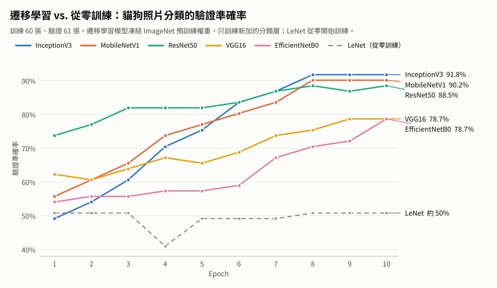

# 深度學習課程實作：CNN 影像分類與卷積

逢甲大學資訊工程學系「深度學習」課程（2025/09–2025/12）的實作整理。用 Keras 比較六種 CNN 架構在小資料集上的表現，並用 OpenCV 觀察卷積核的效果。

## 內容

| Notebook | 內容 | 日期 |
|---|---|---|
| [`01_cnn_transfer_learning_comparison.ipynb`](notebooks/01_cnn_transfer_learning_comparison.ipynb) | 貓狗照片分類：LeNet 從零訓練 vs. 五種 ImageNet 預訓練模型的遷移學習 | 2025/11/04 |
| [`02_opencv_convolution_kernels.ipynb`](notebooks/02_opencv_convolution_kernels.ipynb) | 用 `cv2.filter2D` 套用 Sobel、銳化等卷積核，觀察邊緣偵測與卷積核總和的影響 | 2025/10 |

## 結果：遷移學習 vs. 從零訓練

訓練照片 60 張、驗證照片 61 張。遷移學習模型凍結 ImageNet 預訓練權重，只訓練新加的分類層。

| 模型 | 訓練方式 | 驗證準確率 | 2 張測試照片 |
|---|---|---|---|
| InceptionV3 | 遷移學習 | 91.8% | 都正確 |
| MobileNetV1 | 遷移學習 | 90.2% | 都正確 |
| ResNet50 | 遷移學習 | 88.5% | 都正確 |
| VGG16 | 遷移學習 | 78.7% | 都正確 |
| EfficientNetB0 | 遷移學習 | 78.7% | 都正確 |
| LeNet | 從零訓練 | 約 49% | 誤判 1 張 |

## 觀察

- **只有 60 張訓練照片時，從零訓練學不起來。** LeNet 訓練 15 個 epoch，驗證準確率一直停在 50% 上下，和隨機猜差不多，最後把狗也判成貓。
- **遷移學習在小資料集上很有效。** 預訓練模型已經從 ImageNet 學會抽取邊緣、紋理、形狀等特徵，只要訓練最後的分類層，10 個 epoch 內就能到 79%–92%。
- **驗證準確率有時高於訓練準確率。** 分類層加了 `Dropout(0.5)`，訓練時會隨機關掉一半神經元，驗證時則全部使用；加上驗證集只有 61 張，每張約佔 1.6%，數字本來就容易跳動。
- **卷積核的總和決定亮度，形狀決定效果。** 見 notebook 02：Sobel 抓邊緣、銳化核強化細節；總和為 3 的卷積核會讓畫面過曝。

## 執行方式

1. 在 Google Colab 開啟 notebook。
2. notebook 01：把貓狗照片放進 Google Drive，結構為 `data/train`、`data/validation`、`data/test`，每個資料夾下分 `cats/`、`dogs/`；再把 `BASE_DATA_DIR` 改成自己的路徑。資料集不包含在本 repo 中。
3. notebook 02：不需要準備資料，範例圖使用 scikit-image 內建的 `chelsea`。

## 備註

- 部分程式碼以 AI 助理協助撰寫，實驗執行、結果比較與分析由我完成。
- 2026/10 整理時，修正了 notebook 02 的兩個問題：OpenCV 讀進的 BGR 影像直接用 matplotlib 顯示造成顏色錯誤，以及 Sobel 輸出用 uint8 導致負方向邊緣被截掉。
